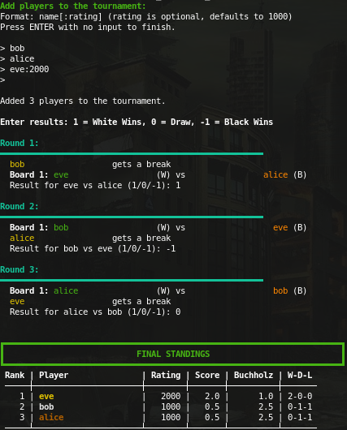

# Rust Chess Tournament Manager

Round-robin tournament manager with a scriptable CLI, saved tournaments and
export. No chess engine, no Swiss pairing (yet) — just a correct round-robin
you can run at the club table.

## Features

- Single or double round-robin schedule (circle method).
- Colour allocation that avoids a third identical colour in a row and keeps each
  player's white/black difference within one.
- Results in chess notation (`1-0`, `0-1`, `1/2-1/2`) or the legacy keys
  (`1`, `0`, `-1`), stored per board so any result can be corrected or undone.
- Byes are part of the round, never a fake player; a bye is worth 1 point.
- Standings with Buchholz, Buchholz cut-1, Sonneborn-Berger, direct encounter
  and most wins, in an order you choose.
- Tournaments are saved to JSON after every result and can be resumed anytime.
- Export games as PGN and standings as CSV.
- Colour only when it makes sense: disabled automatically when output is piped,
  and by `NO_COLOR`.

## Quick start

Requirements: a Rust toolchain (`cargo`).

```sh
cargo build --release
./target/release/ctm --help
```

Interactive, if you prefer prompts:

```sh
./target/release/ctm                 # asks for a name, then players, then plays
```

Scripted, from a players file (`name` or `name:rating` per line, `#` comments
allowed):

```sh
cat > players.txt <<'EOF'
Alice:1820
Bob:1750
Carol
EOF

./target/release/ctm new --name "Autumn Club Cup" --players players.txt
./target/release/ctm -f autumn-club-cup.json run
./target/release/ctm -f autumn-club-cup.json standings
```

`run` pairs one round at a time, prompts for each board, and saves immediately.
Piping results in works too:

```sh
printf '1-0\n1/2-1/2\n' | ./target/release/ctm -f autumn-club-cup.json run
```

## Commands

```
ctm                            wizard: create a tournament and play it
ctm new --name N --players F   create a tournament (--double, --out, --force)
ctm run                        pair the next round and record results
ctm add-player NAME[:RATING]   add a player before the first round
ctm result --round 1 --board 2 0-1
ctm undo   --round 1 --board 2
ctm standings [--tiebreak buchholz,cut1,sb,de,wins]
ctm rounds [--round 2]
ctm export pgn|csv [-o FILE]
```

Global options: `-f/--file <FILE>` (also read from `CTM_FILE`), `--json`,
`--color auto|always|never`, `-q/--quiet`, `-h/--help`, `-V/--version`.

Exit codes: `0` success, `1` usage or state error, `2` I/O or file-format error.

## Tournament file

Saved as JSON next to the tournament (default `<name>.json`). It stores facts
only — players and the games that were actually played — so standings, tiebreaks
and scores are always recalculated from the results:

```json
{
  "version": 1,
  "tournament": {
    "name": "Autumn Club Cup",
    "double_round_robin": false,
    "players": [{ "id": 0, "name": "Alice", "rating": 1820 }],
    "rounds": [{
      "number": 1,
      "games": [{ "board": 1, "white": 0, "black": 1, "result": "1-0" }],
      "bye": 2
    }]
  }
}
```

## Development

```sh
cargo test
```

The suite covers pairing invariants (every pair meets exactly once, nobody plays
twice per round, every odd field receives exactly one bye, colour bounds hold),
derived standings, storage round-trips, and end-to-end CLI behaviour for the
regressions that motivated the rewrite.

**UI:**


